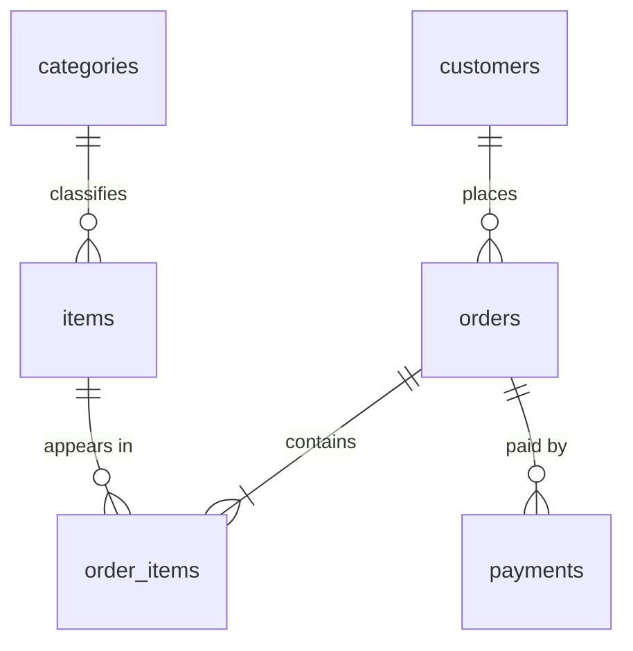

# Zomato SQL Analysis Project (MySQL)

A MySQL project that models a food delivery platform and uses SQL queries to analyse revenue, customers, menu categories and payments.

> **Note:** This is a learning project built on fictional sample data. It is not affiliated with Zomato.

---

## Project Overview

The goal of this project is to design a relational database for a food ordering platform and use SQL to turn raw order data into business insights, such as which items earn the most, how customers pay, and how much revenue is still pending.

**Tech stack:** MySQL, MySQL Workbench

---

## Database Schema

| Table | Description |
|---|---|
| `customers` | Customer profile and contact details |
| `orders` | Order header with delivery address and order timestamp |
| `order_items` | Line items for each order (item, quantity, price) |
| `items` | Menu items with price and category |
| `categories` | Item categories: Vegetarian, Non-Vegetarian, Vegan |
| `payments` | Payment method, status and amount for each order |

### Table Relationships



---

## Business Questions Answered

| # | Analysis | Insight |
|---|---|---|
| 1 | Total revenue | Overall sales from all orders |
| 2 | Revenue by item | Best-selling menu items |
| 3 | Revenue by payment method | Preferred payment channels |
| 4 | Revenue by date | Daily sales trend |
| 5 | Orders and revenue per customer | Customer value |
| 6 | Items ordered by category | Category-wise demand |
| 7 | Orders by payment status | Paid vs pending orders |
| 8 | Customers with most orders | Top customers by order count |
| 9 | Revenue by category | Category contribution to sales |
| 10 | Items in a specific order | Order-level breakdown |
| 11 | Customer details with orders | Customer and delivery report |
| 12 | Revenue by customer | Highest-spending customers |

---

## Example Query

**Revenue by item**

```sql
SELECT i.item_name, SUM(oi.price * oi.quantity) AS total_revenue
FROM order_items oi
JOIN items i ON oi.item_id = i.item_id
GROUP BY i.item_name
ORDER BY total_revenue DESC;
```

**Output**

| item_name | total_revenue |
|---|---|
| Butter Chicken | 600.00 |
| Biriyani | 300.00 |
| Paneer | 100.00 |

---

## Key Insights (from the sample data)

- Total revenue is **₹1,000** across 3 orders.
- **Butter Chicken** is the top item, contributing ₹600 (60% of revenue).
- **Non-Vegetarian** items generate 90% of revenue.
- **1 of 3 payments is still pending**, worth ₹600.

---

## SQL Concepts Used

- Multi-table `INNER JOIN`
- `GROUP BY` and `ORDER BY`
- Aggregate functions: `SUM()`, `COUNT()`
- `LIMIT` for top-N results
- Date functions: `DATE()`
- Primary keys, foreign keys and table relationships
- `DEFAULT CURRENT_TIMESTAMP` for automatic timestamps

---

## Repository Structure

```
Zomato-SQL-Analysis-Project/
├── Zomato_SQL_Analysis.sql   # Database, tables, sample data and 12 analysis queries
└── README.md
```

---

## How to Run

1. Install [MySQL](https://dev.mysql.com/downloads/) and MySQL Workbench.
2. Clone this repository:
   ```bash
   git clone https://github.com/mowriyaathl-comp/Zomato-SQL-Analysis-Project.git
   ```
3. Run the script from the command line:
   ```bash
   mysql -u root -p < Zomato_SQL_Analysis.sql
   ```
   Or open `Zomato_SQL_Analysis.sql` in MySQL Workbench and click **Execute**.
4. The script creates the database, tables and sample data first, then the analysis queries follow. Run them one by one to see each result.

---

## Future Improvements

- Add window functions (`RANK`, `ROW_NUMBER`) for customer and item rankings
- Create views for common reports
- Add indexes and compare query performance
- Build a dashboard in Power BI or Tableau on top of these queries

---

## Author

Mahalakshmi S
LinkedIn -  https://www.linkedin.com/in/mahalakshmi-s-454497281/ 
 GitHub -   https://github.com/mowriyaathl-comp/Zomato-SQL-Analysis-Project

Feedback and suggestions are welcome.